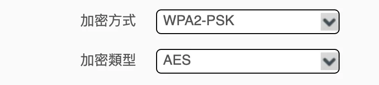
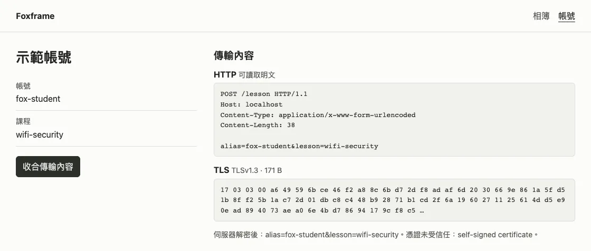

<div class="eyebrow">BambooFox 社課</div>

# Wi-Fi Security

從連上基地台，到驗證網站身分

毛哥EM

<div class="radio-cover" aria-hidden="true"><span></span><ph-wifi-high /></div>

<!--
大家好，我是毛哥 EM。今天我們來看一件每天都在做的事，就是拿出手機，選一個 Wi-Fi，然後打開網站。看起來只有兩個動作，手機其實得先決定要跟哪一台基地台連線，再找到網站的位置，最後確認對方真的是那個網站。

先想一下，你的手機顯示 Wi-Fi 已連線，你覺得它已經確認了哪些事情？有沒有人遇過 Wi-Fi 格數滿格，但什麼網頁都打不開？我們先把這兩個問題留著。下課前，你應該能指出每一個問題要在哪一段找答案。
-->

---
layout: statement
class: say
---

同名 Wi-Fi、同一個鎖頭。

<p v-click class="muted">你知道自己信任的是誰嗎？</p>

<!--
假設你走進一間咖啡店，看到兩個 Wi-Fi 的名字一樣。你會選訊號比較強的那一個，還是會先問店員？再想一步，如果連上去之後，瀏覽器裡的網站也有 HTTPS，你覺得這三件事各能證明什麼？

[click] 我想請大家先用自己的話回答。「我信任的是誰？」如果選的是 Wi-Fi，對象是基地台或網路。如果看的是 HTTPS，對象是網址上的網域。今天我們會把中間這段也補起來。
-->

---

## Agenda

<div class="wifi-stack">
<div><strong>00:00–00:25</strong><span>從 Wi-Fi 連線到打開網頁</span></div>
<div><strong>00:25–00:55</strong><span>WPA2、WPA3 與密碼驗證</span></div>
<div><strong>00:55–01:25</strong><span>假基地台、管理訊框與區網路徑</span></div>
<div><strong>01:25–01:35</strong><span>休息</span></div>
<div><strong>01:35–02:30</strong><span>HTTPS、憑證與兩個本機練習</span></div>
<div><strong>02:30–03:00</strong><span>防護設定、測驗與問答</span></div>
</div>

<!--
前半堂先把 Wi-Fi 連線拆開，再看同樣是輸入 Wi-Fi 密碼，WPA2 和 WPA3 兩邊到底在做哪一些不同的事。接下來會換一個角度。就算對方不知道你的 Wi-Fi 密碼，有辦法影響你的連線路徑時，還能做什麼？

休息回來，我們會看三條真實錄下來的本機連線、比較 HTTP 跟 TLS，再用相簿示範傳輸內容改變時畫面會有什麼差別。最後有八題小測。你現在就可以想一個自己遇過的網路問題，等到最後試著說出它落在哪一層。
-->

---
layout: full
class: px-14
title: 關於我
description: 我是毛哥EM
---

<div class="h-full grid grid-cols-[1fr_420px] items-center">
<div>

**關於我**

## 毛哥EM

- 十年網頁開發經驗
- 國際網頁設計競賽 Awwwards - 常態評審
- 交大網路安全策進會 - 社長
- 交大軟體開發社 - 前端開發組長、設計組長
- 交大人機互動與創意計算實驗室 - 網管
- SITCON 2026 - 開發組長

</div>

<div class="flex justify-center">
    
</div>
</div>

<!--
先簡單自我介紹一下。我是毛哥 EM，平常做網頁開發，也在 BambooFox 跟大家一起做資安活動。我會從平常做網站和排查網路時遇到的情境開始。今天就算是第一次開 Wireshark 也可以跟上，等一下每一步我們一起看。
-->

---
layout: section
---

<div class="eyebrow">Wi-Fi 與網路</div>

# 按下「連線」之後

<!--
我們先從按下「連線」那一秒開始。手機會先找到一台基地台，接著拿到能在區網裡通訊的設定。最後，等你真的打開網頁，它才會去查這個網站在哪裡，並且確認伺服器身分。

這幾個階段可以分開成功或失敗。等一下看流程圖時，先把「我已經連上 Wi-Fi」跟「我打得開想看的網站」當成兩件事來想。
-->

---

## 家裡的分享器做了幾份工作？

<div class="wifi-path">
<strong>手機 / 筆電</strong><span>↔</span><strong>AP</strong><span>↔</span><strong>Switch / Router</strong><span>↔</span><strong>Modem / ONT</strong><span>↔</span><strong>ISP</strong>
</div>

| 角色            | 工作                                  |
| --------------- | ------------------------------------- |
| STA / AP        | 無線用戶端 / 提供無線連線             |
| Switch / Router | 轉送區網訊框 / 在 IP 網路之間轉送封包 |
| DHCP / NAT      | 提供 IP 設定 / 轉換網路位址           |
| Modem / ONT     | 接上電信商的線路                      |

<!--
這張圖從左往右看。手機是無線用戶端，基地台負責接收和傳送手機的無線訊號。進到區網之後，交換器幫裝置轉送訊框，路由器負責把封包送往另外一個 IP 網路。最右邊的光纖終端或數據機，才接到電信商的線路。

家裡通常是一台盒子把幾個功能包在一起，所以我們習慣管整台叫分享器。我問一個問題，如果拔掉分享器接外網的那條線，手機還能不能連家裡的印表機？如果兩台裝置還在同一個能互通的區網，通常可以。這就是 Wi-Fi 跟 Internet 可以分開看的一個例子。
-->

---

## 名稱、位址和身分

<div class="grid grid-cols-3 gap-4 mt-5">
<div class="card"><h3>SSID</h3><p>顯示給人的網路名稱，多個 AP 可以共用。</p></div>
<div class="card"><h3>BSSID</h3><p>識別一個基本服務集，常呈現為 AP 的 MAC 位址。</p></div>
<div class="card"><h3>MAC 位址</h3><p>鏈路層位址。用戶端可能使用隨機化位址。</p></div>
</div>

<p class="lead !mt-7">要確認 AP 身分，仍需看網路的認證方式和裝置的信任設定。</p>

<!--
手機清單上看到的網路名稱叫 SSID。學校可以每棟樓、每層樓都用同一個名字，讓手機移動時繼續用同一套網路設定。BSSID 則可以把畫面縮小到其中一個無線服務，通常長得像一組 MAC 位址。一台基地台提供多個無線服務時，也可能有多組 BSSID。

如果有人在附近廣播一樣的名字，單看名字就分不出來。MAC 位址也可以仿冒，手機甚至會按設定換成隨機化的位址。要判斷你現在連到的對象，得再看裝置要求哪種認證，以及它接受哪些身分。
-->

---

## 頻段、Wi-Fi 世代和安全模式

| 看見的標籤          | 它說明什麼                                         |
| ------------------- | -------------------------------------------------- |
| 2.4 / 5 / 6 GHz     | 使用的頻段。傳播、干擾與可用頻譜不同               |
| Wi-Fi 4 / 5 / 6 / 7 | 802.11n / ac / ax / be；6E 將 Wi-Fi 6 延伸到 6 GHz |
| WPA2 / WPA3 / OWE   | 連線採用的認證和鏈路保護                           |

<p class="lead">同一台 Wi-Fi 6 設備，在 5 GHz 仍可能使用 WPA2；6 GHz 有另外的安全要求。</p>

<!--
這幾個數字很容易混。二點四、五、六 GHz 是無線訊號用的頻段。Wi-Fi 四、五、六、七是通訊技術的世代，跟能用哪些傳輸方式有關。WPA2 和 WPA3 才是在講這段連線怎麼做認證、怎麼保護資料。

例如一台 Wi-Fi 6 的分享器，在五 GHz 還是可以用 WPA2。六 GHz 的安全模式要求比較嚴格，一般會看到 WPA3 或 Enhanced Open。下次看到產品外盒寫 Wi-Fi 6，可以另外打開設定確認目前到底用了哪種安全模式。
-->

---

## 從無線連線到網站

<div class="wifi-stack">
<div><strong>掃描</strong><span>Beacon / Probe，找得到哪些 AP？</span></div>
<div><strong>認證與關聯</strong><span>802.11 Authentication / Association，協商連線能力。</span></div>
<div><strong>金鑰建立</strong><span>例如 WPA2/WPA3 的 4-Way Handshake。</span></div>
<div><strong>網路設定</strong><span>例如 DHCP 提供 IP、預設閘道、DNS。</span></div>
<div><strong>應用連線</strong><span>DNS 查詢，經 TCP + TLS 或 QUIC + TLS 存取 HTTPS。</span></div>
</div>

<!--
手機先聽基地台廣播，或主動問周圍有哪些網路。選定之後會進入 802.11 的認證和關聯流程，雙方協商要用什麼方式連。典型 WPA2 的初步認證不檢查 Wi-Fi 密碼。WPA3 用的 SAE 會在正式關聯前先驗證雙方是否掌握密碼，關聯之後再建立保護資料的金鑰。

接著舉 IPv4 的例子。手機通常會透過 DHCP 拿到自己的 IP、預設閘道跟 DNS。到這裡才具備往外找網站的一些基本條件。如果你看到 Wi-Fi 格數好好的，卻打不開網頁，先想它有沒有拿到 IP、能不能到閘道、DNS 能不能查，或者網路是不是還在等你開入口頁面。
-->

---

## 電波可以收到，內容有不同可見性

<div class="grid grid-cols-3 gap-4 mt-5">
<div class="card"><h3>接收電波</h3><p>設備與頻道決定收到哪些無線訊框。</p></div>
<div class="card"><h3>辨識標頭</h3><p>可辨識訊框類型、部分位址或時間。</p></div>
<div class="card"><h3>解讀資料</h3><p>取決於鏈路加密，以及上層是否使用 TLS。</p></div>
</div>

<p class="lead !mt-7">Monitor Mode 可以提供原始 802.11 訊框，支援程度依網卡、驅動、作業系統與頻道而異。</p>

<!--
無線訊號在空氣中傳，附近如果有支援的接收設備，也可能收到同一個訊框。收到之後，第一件可以做的是辨認它的外層，例如這是哪一類訊框、有哪些看得到的位址。至於裡面真正傳的內容，如果受加密保護，就還需要相對應的金鑰。網站也可能在上面再加一層 TLS。

有人開 Wireshark 看不到附近基地台的 Beacon，這很常見。一般網路介面提供的是作業系統交給你的封包。要觀察原始的 802.11 訊框，得看網卡、驅動跟作業系統是否支援監聽模式，還要看設備目前在哪個頻道。等一下的 Wireshark 練習用的是本機介面，目標是看 HTTP 跟 TLS。
-->

---
layout: section
---

<div class="eyebrow">WPA2 與 WPA3</div>

# 無線連線怎麼建立信任？

<!--
我們現在來回答，基地台跟手機都說自己知道密碼，雙方怎麼核對這件事？知道密碼之後，它們又怎麼弄出只給這次連線使用的金鑰？

等一下會分開兩個問題。第一個是主金鑰從哪裡來，第二個是拿到主金鑰之後，這一台手機跟基地台怎麼建立工作金鑰。記住這兩個問題，看到 WPA3 時比較容易看出到底改了哪一段。
-->

---

## 安全模式保護哪些東西？

| 模式          | 認證或鏈路保護                             |
| ------------- | ------------------------------------------ |
| 傳統 Open     | 開放加入，無 WPA 鏈路加密                  |
| Enhanced Open | 透過 OWE 建立個別鏈路加密，AP 身分未經認證 |
| WPA2-Personal | 共享密碼衍生金鑰，常見 AES-CCMP            |
| WPA3-Personal | SAE 密碼驗證與金鑰交換，要求 PMF           |
| Enterprise    | 802.1X / EAP，信任取決於方法及用戶端設定   |

<!--
安全模式有三件事可以分開問。誰有資格加入，這叫認證。別人能不能讀到內容，這叫機密性。資料中途被改過，我能不能發現，這叫完整性。

來對照這張表。傳統開放網路讓裝置直接加入，無線那一段沒有 WPA 加密。Enhanced Open 也不用密碼，但會替你和基地台建立個別的加密連線。這會保護你免於一部分被動旁聽，基地台的身分仍然沒有經過認證。家用的 Personal 則靠共享密碼，學校或公司的 Enterprise 還會要求我依照組織的設定驗證認證伺服器。每一種處理的問題不太一樣。
-->

---

## WPA 一代一代改了什麼？

<div class="wifi-stack">
<div><strong>WEP</strong><span>用來混合金鑰的數值太短，容易重複，加上其他設計弱點，保護失效（RC4、IV）。</span></div>
<div><strong>第一代 WPA</strong><span>先讓舊網卡繼續用，換一套規則混合金鑰與檢查資料（TKIP）。</span></div>
<div><strong>WPA2</strong><span>典型做法改用 AES 保護資料（CCMP），個人模式仍從共享密碼算主金鑰。</span></div>
<div><strong>WPA3</strong><span>個人模式改成雙方用密碼一起建立主金鑰（SAE）。</span></div>
</div>

<!--
最早的 WEP 用的是一套現在已經不安全的加密設計。它有一個數值空間很小，用久了可能重複，加上其他設計問題，換一組更難猜的密碼也救不了。廠商當時又不能叫大家立刻把網卡全部換掉，所以第一代 WPA 先推出一個過渡做法。它沿用部分舊硬體能做的 RC4，再用一套混合金鑰和檢查完整性的規則，也就是 TKIP，補強當時的資料保護。

後來 WPA2 的典型做法改用基於 AES 的 CCMP，資料怎麼保護這一段變了。但在 WPA2-Personal 裡，基地台和手機還是從同一組共享密碼取得主金鑰。到 WPA3-Personal，這一步改成由雙方用密碼一起協商。等一下我們慢慢拆。
-->

---

## 看一眼實際的 TOTOLINK 設定

<div class="wifi-evidence mt-5">
<figure>

<figcaption class="lab-caption text-center">TOTOLINK 管理介面截圖，保留本次例子需要的加密兩欄。</figcaption>
</figure>
</div>

<p class="lead !mt-5">WPA2-PSK 是網路的安全模式，AES 是這個介面的加密類型標示。</p>

<!--
這張是實際的 TOTOLINK 設定畫面。上面寫 WPA2-PSK，指的是這台分享器選的安全模式，對應我們要談的 WPA2 個人模式。下面寫 AES，是這個管理介面顯示的加密類型。

看到 AES，有人會問，那為什麼前面還說弱密碼有風險？因為這兩欄對應兩件事。知道它用什麼方法保護資料，還要問它怎麼建立那些保護資料的金鑰。接下來就從你在手機上輸入的那組密碼開始看。
-->

---

## WPA2 怎麼從密碼算出主金鑰？

<div class="wifi-path">
<strong>Wi-Fi 密碼</strong><span>＋</span><strong>網路名稱（SSID）</strong><span>→</span><strong>主金鑰（PMK）</strong>
</div>

- 手機跟基地台各自在本機算。輸入相同，結果就相同。
- 把公開的網路名稱一起算進去，換個名稱就會得到不同結果。
- 主金鑰還會用來產生這次連線用的工作金鑰。

<!--
以一般人在手機上輸入文字密碼的 WPA2 為例，分享器原本就有這組密碼，手機也拿到了。兩邊各自把密碼和同一個 Wi-Fi 名稱放進固定的金鑰衍生運算，結果就會一樣。這個結果是一份主金鑰材料，縮寫叫 PMK。

Wi-Fi 名稱是公開的，在這裡能讓兩個不同名稱的網路，即使剛好設了同一組密碼，也算出不同的主金鑰。反過來，同一個名稱、同一組密碼，每次重算都會得到原來的主金鑰。這個特性等一下很重要。接下來還需要為這一場連線算出工作金鑰，才會拿去實際保護資料。
-->

---

## WPA2 的四步交握在做什麼？

| 誰傳給誰         | 每一步在做什麼                                              |
| ---------------- | ----------------------------------------------------------- |
| 1. 基地台 → 手機 | 基地台送出這次新選的隨機數（ANonce）。                      |
| 2. 手機 → 基地台 | 手機送出自己的隨機數（SNonce）和用金鑰算出的檢查碼（MIC）。 |
| 3. 基地台 → 手機 | 基地台核對成功後，送回自己的檢查碼和包好的群組金鑰（GTK）。 |
| 4. 手機 → 基地台 | 手機核對成功，回覆確認。                                    |

<p class="lead">雙方用主金鑰、兩個隨機數和雙方位址，各自算出這次連線的工作金鑰（PTK）。</p>

<!--
現在手機跟基地台各自有一份相同的主金鑰。基地台先傳一個這次新選的隨機數給手機，封包欄位叫 ANonce。手機也有自己新選的隨機數，叫 SNonce。手機把這兩個數、雙方位址和主金鑰一起用，算出這次連線的工作金鑰組。

第二步，手機把自己的隨機數送出去，並用剛算好的金鑰做出一個檢查碼，附在訊息上。這個檢查碼就是 MIC。基地台現在也拿齊兩個隨機數了。它算出自己的工作金鑰，再用它檢查手機的訊息。檢查通過，代表兩邊算出了一致的金鑰。

第三步是基地台回覆一份可驗證的訊息給手機，並把群組用的金鑰包好一起送過去。那組金鑰用於廣播或群組流量。第四步就是手機確認收到。整個離開裝置的，是這次交換的隨機數、檢查碼和相關資料。兩邊原本知道的 Wi-Fi 密碼一直留在自己的裝置裡。
-->

---

## 為什麼 WPA2 弱密碼有離線猜測風險？

<div class="grid grid-cols-2 gap-4 mt-6">
<div class="card"><h3>猜一組密碼，能重算主金鑰</h3><p>在 WPA2-Personal，文字密碼加上公開的網路名稱，就決定主金鑰。</p></div>
<div class="card"><h3>交握紀錄留下檢查依據</h3><p>有足夠的紀錄，就可能在自己的電腦核對猜測，無須每次向基地台詢問。</p></div>
</div>

<p class="lead !mt-7">常見單字、日期和組織名稱容易被猜到。隨機產生的密碼更難猜中。</p>

<!--
剛剛這個流程有個地方值得停一下。手機發出來的檢查碼，本來是要讓基地台確認兩邊有沒有算出一致的金鑰。如果旁人留下足夠完整的握手紀錄，這份紀錄裡也可能留下能核對密碼猜測的依據。

原因是這個模式下，猜到一組密碼之後，主金鑰是可以根據同一個公開名稱重新算出來的。而這次握手另外用到的隨機數和位址，有一部分本來就會出現在交換裡。換句話說，對方有機會在自己的電腦驗證猜測，無須每猜一次就重新跟基地台互動。真正有用的防護是讓密碼難以猜中。常見詞、社團名加年份即使有點長，也很容易排在猜測的前面。
-->

---

## WPA3 怎麼用密碼一起建金鑰？

<div class="wifi-stack">
<div><strong>兩邊知道同一組密碼</strong><span>各自在本機把它轉成交換要用的數學材料（PWE）。</span></div>
<div><strong>交換公開資料（Commit）</strong><span>各自用這次新產生的隨機秘密做運算，只送公開結果。</span></div>
<div><strong>互相確認（Confirm）</strong><span>兩邊各算出一份共同秘密，再互驗對方送來的證明。</span></div>
<div><strong>連線用的金鑰</strong><span>從共同秘密算出主金鑰（PMK）。建立關聯後，仍走四步交握。</span></div>
</div>

<!--
現在換到 WPA3-Personal。你一樣在手機打同一組 Wi-Fi 密碼，但裡面跑的是一個叫 SAE 的協定。手機和基地台先在各自的裝置上，把密碼轉成共同的數學材料。以常見做法來說，可以把它理解成一個只有知道密碼才能找得到的曲線上的點。

接下來第一輪叫 Commit。兩台裝置各自產生這次才用的隨機秘密，把它跟密碼的數學材料一起運算，再交換算過的資料。注意傳出去的是運算結果。兩邊用的私人隨機值各自留在本機。拿到對方的資料以後，加上自己剛才留在本機的秘密，兩邊就能算出相同的一份共同秘密。

第二輪叫 Confirm。兩邊用共同秘密衍生出的驗證金鑰，各發一份短證明給對方。驗證通過，才確認我們真的算到了同一份秘密。它們也從這份秘密得到主金鑰。這些發生在正式關聯前。等關聯之後，你還是會看到剛剛講的四步交握，拿新的主金鑰去建立實際保護流量的工作金鑰。
-->

---

## 為什麼錄下 WPA3 還不能離線猜？

<div class="grid grid-cols-2 gap-4 mt-5">
<div class="card"><h3>WPA2｜猜中就能重算</h3><p>猜測的密碼加上公開的網路名稱，就能重算主金鑰。有足夠的交握紀錄時，也能核對猜測。</p></div>
<div class="card"><h3>WPA3｜每次都有新的私人秘密</h3><p>猜到密碼也只知道共同的起始材料。缺少當時留在端點的秘密，無法從錄下的封包算出當次金鑰來比對。</p></div>
</div>

<p class="lead !mt-6">如果過渡模式共用同一組密碼，走 WPA2 的裝置仍可能留下可離線驗證的交握紀錄。</p>

<!--
現在回到這堂最重要的問題，如果旁人把封包全錄下來，能不能像 WPA2 那樣，每猜一組密碼就照原本的流程核對？大家看左邊。WPA2 這邊，密碼跟公開的網路名稱就決定了主金鑰。只要手上有足夠的握手紀錄，就可能在自己的電腦判斷猜得對不對。

再看右邊的 WPA3。假設我剛好猜對了，我確實可以算出那份從密碼來的數學材料。但接下來我還要算到當初那兩台裝置建立的共同秘密。它們各自用的隨機秘密沒傳出去，而公開的 Commit 也不會讓旁觀者直接取回這些值。所以只拿錄下來的封包，即使我猜對密碼，也無法依這條路重算當次的主金鑰、自行核對 Confirm，或者核對後面四步交握的檢查碼。對正確實作的正常 SAE，猜測一般得跟對方真的互動，錄一次不能一直檢查。

最後看過渡模式。如果家裡的基地台同時讓新手機走 WPA3、老設備走 WPA2，兩邊還共用一組密碼，那老設備的 WPA2 連線仍有剛剛說的離線猜測風險。如果有人從 WPA2 那邊得知共用密碼，他可能用它加入網路。光靠那組密碼和舊封包，仍無法還原先前 WPA3 連線的金鑰。這兩件事要分開。
-->

---

## Enterprise 與 eduroam

- 用戶端透過 802.1X / EAP 驗證，常由 RADIUS 服務支援。
- EAP-TLS 可用憑證驗證；PEAP、EAP-TTLS 用 TLS 建立受保護的通道。
- 用戶端須按組織提供的設定驗證伺服器憑證及預期身分。

<p class="lead">使用學校官方的 eduroam 設定或 CAT / geteduroam 設定檔。</p>

<!--
再來看 Enterprise。家用分享器可能全家共用一組密碼，學校或公司則希望能分辨哪一個帳號或哪一台裝置在連線，就會使用像 802.1X 和 EAP 這類方式，後面通常有認證伺服器。依照設定，認證可能用憑證，也可能會在 TLS 通道裡繼續驗證帳號。

拿 eduroam 來說，裝置跳出視窗請你接納一張憑證時，別只看 Wi-Fi 名稱是不是 eduroam。應該用學校提供的設定核對認證伺服器的身分。官方設定檔可以先把應該信任的伺服器和憑證範圍設好，避免每一次都靠你肉眼猜。
-->

---

## 練習｜不用輸入密碼就能加入 Wi-Fi？

| 網路的做法               | 裝置如何加入                          | 這段連線有什麼保護                               |
| ------------------------ | ------------------------------------- | ------------------------------------------------ |
| 傳統開放網路（Open）     | 選取名稱即可加入                      | 無 WPA 鏈路加密。網站仍可使用 HTTPS              |
| Enhanced Open（OWE）     | 支援的裝置可直接加入                  | 裝置跟基地台各自建立加密連線，基地台身分未經認證 |
| 主人分享 WPA2／WPA3 網路 | 透過官方 QR Code 或裝置的密碼分享加入 | 裝置取得加入所需的設定，再完成原本的 Wi-Fi 認證  |

<p class="lead">有些訪客網路連上後會再跳出網頁入口。入口頁和 Wi-Fi 認證是兩個步驟。</p>

<!--
我們先做一個常見的生活題。有沒有可能完全不打 Wi-Fi 密碼就連得上？有。如果店家開的是傳統 Open，你選名字就可以加入。在那一段無線鏈路，沒有 WPA 提供的加密。如果店家開的是 Enhanced Open，而且你的裝置也支援，你一樣不必輸入密碼，但裝置和基地台會建立加密連線。就算是 Enhanced Open，還是要跟店家核對名字，因為它沒有幫你驗證基地台是誰。

還有一種情況是主人秀 QR Code 給你掃。你沒有手打密碼，裝置仍然是拿到加入所需的設定，再去跑原本的認證。這兩種「沒輸入」的意思不一樣。最後，有些網路讓你先加入，再跳出一個網頁請你確認條款，那是網頁入口的要求。
-->

---

## 操作｜加入公開或受邀的 Wi-Fi

1. **問清楚網路名稱。** 向場地方確認訪客網路的名稱和加入方式。附近有同名網路時，先向對方核對。
2. **打開 Wi-Fi 設定。** iPhone 或 iPad 進「設定 → Wi-Fi」。Android 進「設定 → 網路和網際網路 → 網際網路」，選場地方提供的名稱。
3. **依網路類型加入。** Open 或 Enhanced Open 可直接選取。若是受保護網路，請管理者提供訪客 QR Code 或裝置分享，並確認掃到的名稱。
4. **驗證連線。** 確認 Wi-Fi 設定顯示已連線。若有官方入口頁，完成入口流程後，用一個你熟悉的 HTTPS 網站確認能上網。

<p class="lab-caption"><a href="https://support.apple.com/en-us/111107">Apple Wi-Fi 操作說明</a> · <a href="https://support.google.com/android/answer/9075847">Android Wi-Fi 與 QR Code 說明</a></p>

<!--
實際操作時，我先向場地方問這個訪客網路叫什麼、要不要掃碼。等一下請打開手機的 Wi-Fi 設定，在清單選你剛剛確認的名字。如果這是公開的 Open 或 Enhanced Open，支援的裝置選了就可以加入。如果裝置問我要 WPA 密碼，我會回去找管理者，請他給訪客網路或分享設定。若對方願意，可以請他用支援的裝置把 QR Code 顯示出來，我掃描後再核對畫面上的網路名稱。

連上以後先看 Wi-Fi 設定有沒有顯示連線。再確認瀏覽器真的能用這個 Wi-Fi 打開一個熟悉的 HTTPS 網站。手機有時候會切去行動網路，所以如果只是看到網頁打開，最好再確認剛剛那段連線實際走的是哪裡。
-->

---

## 操作｜用 QR Code 邀請朋友加入

<div class="grid grid-cols-2 gap-4 mt-5">
<div class="card"><h3>iPhone</h3><p>打開「密碼」App →「Wi-Fi」→ 選網路 →「顯示網路 QR Code」。</p></div>
<div class="card"><h3>Android</h3><p>在已連線的裝置中開「設定 → 網路和網際網路 → 網際網路」，選該網路 →「分享」。必要時先解鎖驗證。</p></div>
</div>

<p class="lead !mt-6">受邀的人用相機或 Wi-Fi 的掃碼功能，核對網路名稱後加入。</p>

<p class="lab-caption"><a href="https://support.apple.com/guide/iphone/iph96e6aa9bb/ios">Apple QR Code 分享說明</a> · <a href="https://support.google.com/android/answer/9075847">Android QR Code 分享說明</a></p>

<!--
如果我要讓朋友連到我有權分享的網路，我會把這一頁給他看。iPhone 可以從密碼 App 裡選那個 Wi-Fi，顯示網路 QR Code。Android 則可以從目前網路的設定選「分享」。畫面上的選單名稱可能依手機而異，先找已連線的那個網路就好。

朋友掃描的時候，先看手機上顯示的名稱是不是我剛剛說的那個，再按加入。這時手機拿到加入所需的資料，只是使用者沒有自己打密碼。因為這個 QR Code 可以讓人加入，所以跟密碼一樣，只提供給你要邀請的人。
-->

---
layout: section
---

<div class="eyebrow">假基地台與網路路徑</div>

# 如果有人控制了路徑呢？

<!--
剛剛我們一直在說，要怎麼證明裝置知道 Wi-Fi 密碼。接下來換一個情境。假設有人想誘導你選錯網路，或是你的封包本來就會經過某個對方能控制的地方。這個人能做的事，跟猜到 Wi-Fi 密碼有什麼差別？

我們會從同名網路、斷線通知和區網設定各看一個例子，最後再用 HTTPS 回答路徑遭介入時，哪些資料還能受到保護。
-->

---

## Evil Twin 與 Rogue AP

<div class="grid grid-cols-2 gap-4 mt-6">
<div class="card"><h3>Evil Twin</h3><p>用相同或相似的 SSID 冒充熟悉的網路，可能搭配假入口頁面。</p></div>
<div class="card"><h3>Rogue AP</h3><p>未經授權的基地台。是否冒充既有網路，取決於它的用途。</p></div>
</div>

<p class="lead !mt-7">用戶端會依已儲存的設定、安全模式、認證與連線政策來選擇 AP。</p>

<!--
還記得咖啡店的例子嗎？同一個網路名稱可以是店家自己擺了兩台基地台，也有可能是別人刻意用同樣的名字。故意冒充熟悉網路的情境，就是 Evil Twin。Rogue AP 比較廣，意思是未經授權的基地台，例如有人自行把一台設備接進辦公室網路。

手機會拿自己記得的安全模式和認證設定來決定要不要連。光把訊號開大，也不能讓不知道密碼的基地台通過正常的 SAE。反而要注意開放網路和入口頁。如果一個咖啡店入口突然要你輸入社群網站的密碼，你應該先停下來，用店家提供的資訊核對。
-->

---

## PMF 保護哪些管理訊框？

- Deauthentication 解除認證，Disassociation 解除關聯。
- PMF 保護特定 robust management frames，包含安全連線建立後的部分斷線通知。
- 射頻干擾和其他可用性問題，要用各自的方式診斷。

<!--
手機和基地台平常除了傳資料，也會傳管理網路連線用的訊息。有些訊息是說「這個連線要結束了」，就像基地台通知手機要離線。舊式情況下，裝置可能無法驗證這類訊息到底是誰送的。

PMF 會替特定管理訊框加上保護，讓安全連線建立之後，裝置可以檢查部分斷線通知的來源和完整性。你可以把它跟無線電本身的干擾分開想。一邊是收到了一則假的通知，另一邊是訊號被干擾到收不起來。PMF 處理的是前者的其中一部分。
-->

---

## WPS、PMKID、KRACK 分別在哪一層？

| 名稱    | 涉及的機制                        | 防護重點                       |
| ------- | --------------------------------- | ------------------------------ |
| WPS PIN | 部分舊實作的配對 PIN 弱點         | 關閉不需要的 PIN，更新韌體     |
| PMKID   | 某些設定下提供離線驗證材料        | 高熵密碼，盤點 WPA2 與設備設定 |
| KRACK   | 受影響實作的金鑰重裝與 nonce 重用 | 更新 AP 與用戶端               |

<!--
這三個名字常常一起出現，但看的是不同地方。WPS 是方便裝置配對的機制。部分舊設備的 PIN 做法有缺陷，所以即使你的 Wi-Fi 密碼設得很難猜，額外開著這種配對入口還是會有風險。

PMKID 可以把它理解成一個用來辨認主金鑰關聯的識別值。有些 WPA2 設定或實作會留下可供離線驗證的材料，是否存在得看設備和情境。KRACK 則是一些實作在處理交握重傳時，可能把已用過的金鑰裝一次又一次，引發重用問題。聽到 KRACK 要想到更新基地台和用戶端，兩邊都要看。
-->

---

## MITM 與被動觀察

<div class="wifi-path"><strong>用戶端</strong><span>↔</span><strong>網路路徑</strong><span>↔</span><strong>服務端</strong></div>
<div class="wifi-path"><strong>用戶端</strong><span>↔</span><strong>可控制通訊的中間節點</strong><span>↔</span><strong>服務端</strong></div>

- 被動觀察只能從可見的流量找資訊。
- 能介入路徑的一方還可能延遲、阻斷或修改未受保護的訊息。
- TLS 驗證與加密會影響對方能讀取或修改的內容。

<!--
上面一條路徑，你的裝置把資料交給中間的設備轉送，最後到伺服器。旁邊有人能看到一部分流量，這叫被動觀察。下面一條路徑，如果有人能控制中間那個節點，他除了有機會觀察，也可能把連線拖慢、擋掉，甚至改掉沒受到保護的內容。這就是中間人所在的位置。

那如果你用 HTTPS 呢？他還是可能擋掉你的連線。但要冒充真正的網站，仍要讓你裝置的 TLS 驗證通過。等一下我們在同一台電腦跑一次，看看收到陌生憑證時會發生什麼。
-->

---

## ARP、DHCP、DNS 各處理什麼？

| 機制 | 正常用途                     | 受干擾可能發生什麼           |
| ---- | ---------------------------- | ---------------------------- |
| ARP  | 在 IPv4 區網查詢下一跳的 MAC | 流量被送往錯誤裝置           |
| DHCP | 提供 IP、閘道與 DNS 等設定   | 用戶端取得有問題的路徑設定   |
| DNS  | 查詢名稱對應的紀錄           | 用戶端連向錯誤位置或連線失敗 |

<p class="lead">區網隔離會改變能互通的對象；TLS 會另外驗證目的地身分。</p>

<!--
這三個協定各回答不同的問題。ARP 回答「我要把這個區網封包交給哪個 MAC 位址」。DHCP 回答「我的 IP、預設閘道和 DNS 是什麼」。DNS 則回答「這個名字對應到哪裡」。哪一個答案出了問題，封包走的路就可能不一樣。

這裡講 ARP 是以 IPv4 同一個區網為例。你跟別人連同一個 Wi-Fi，裝置彼此能不能直接通訊，還會受區網隔離影響。網站這端另外有一個判斷。舉例來說，如果 DNS 把你指向別的 IP，瀏覽器仍會檢查對方有沒有原本那個網域的有效憑證。
-->

---
layout: statement
class: say
---

先休息 10 分鐘。

<p class="sub">回來後，把同一份資料用 HTTP 和 TLS 各傳一次。</p>

<!--
好，我們先休息十分鐘。回來會拿同一份固定資料，用 HTTP 跟 TLS 分別傳一次。可以先點開練習專案，或者把 Wireshark 的封包檔下載好。等一下如果環境來不及裝，我會直接用投影片上的實測畫面帶大家做。
-->

---
layout: section
---

<div class="eyebrow">HTTP、HTTPS 與實作</div>

# 到了網站這一段，誰能看見什麼？

<!--
歡迎回來。剛才我們一路從無線連線走到網路路徑。現在終點換成一個網站。就算有人可以看見你跟網站交換的封包，他能看到什麼、又能改什麼？

等一下我們先看一份固定樣本，再換成圖片。看結果之前先猜一下。如果我把同一個帳號值放在兩份請求裡，你覺得在哪一份封包可以直接找到這串字？
-->

---

## HTTPS 的保護從哪裡來？

<div class="grid grid-cols-3 gap-4 mt-6">
<div class="card"><h3>身分驗證</h3><p>檢查名稱、有效期、信任鏈及是否掌握私鑰。</p></div>
<div class="card"><h3>建立金鑰</h3><p>TLS 1.3 完整握手常用暫時性金鑰交換，例如 ECDHE。</p></div>
<div class="card"><h3>傳輸保護</h3><p>對 HTTP 路徑、查詢、標頭與內容提供機密性及完整性。</p></div>
</div>

<p class="lead !mt-7">鏈路可能是 WPA2、WPA3、有線或行動網路，TLS 會建立自己的工作階段保護。</p>

<!--
一個 HTTPS 連線大致要做三件事。先驗證對方有沒有資格代表你網址上的網域。瀏覽器會檢查憑證是否適用於這個名字、是否還有效、信任鏈是否成立，也會檢查對方能不能證明自己有對應的私鑰。

接著雙方會建立用來保護這次通訊的金鑰。例如常見的 TLS 1.3 完整交握會用暫時的金鑰交換。最後才用工作金鑰保護 HTTP 的內容，包括網址裡網域之後的路徑和查詢、標頭跟內文。你切換到行動網路，仍會跑這套網站自己的驗證。Wi-Fi 密碼不參與這個過程。
-->

---

## 練習程式｜在自己的電腦執行

<p class="lead"><a href="https://github.com/BambooFox/wifi-security-lab">github.com/BambooFox/wifi-security-lab</a></p>

```sh
git clone https://github.com/BambooFox/wifi-security-lab.git
cd wifi-security-lab
python3 lab.py
```

開啟 <http://127.0.0.1:8765/>。需要支援 TLS 1.3 的 Python 和 `openssl`。

<!--
可以開投影片上的 GitHub 連結。用 Git 的同學照畫面上的三行指令執行。如果你不想用 Git，也可以直接 Download ZIP，解開後從資料夾裡執行 lab.py，再開畫面上的本機網址。

如果 Mac 內建的 Python 顯示不支援 TLS 1.3，可以改用新版 Python。這台展示用的 Mac 用的是 Homebrew 安裝的 Python。現在請大家先開到首頁。想跟著看封包的同學，等一下可以再開專案裡的 Wireshark 練習。
-->

---

## Demo A｜固定樣本的 HTTP / TLS 實測

<div class="wifi-evidence wifi-result">
<figure>

<figcaption class="lab-caption text-center">本機瀏覽器截圖，TLS 記錄由兩個記憶體端點實際交換。</figcaption>
</figure>
<dl>
<dt>明文 HTTP</dt><dd>看得到固定帳號<br /><span class="mono">fox-student</span></dd>
<dt>TLS 1.3</dt><dd>服務端解密後讀到同一份資料</dd>
<dt>未信任測試憑證</dt><dd>用戶端拒絕連線</dd>
</dl>
</div>

<!--
現在看帳號頁。我按「比較 HTTP 與 TLS」。左側只有固定公開的樣本帳號，右側一打開，你可以在 HTTP 欄的請求內容直接看到 fox-student。往下一格，我們用同一份資料實際跑了一次 TLS 1.3。應用資料這時變成加密記錄，畫面顯示其中一段十六進位。你在這一段找不到剛才的字串。

伺服器端拿到對應的金鑰，解開後仍收到同一份資料。這是本機程式真的傳出的 TLS 記錄。稍後用 Wireshark 時，我們會從另一份實際的 TCP 擷取看同樣的差別。
-->

---

## 誰決定憑證可不可以信任？

| 這次實驗的用戶端                 | 觀察結果                     |
| -------------------------------- | ---------------------------- |
| TLS context 明確信任暫存測試憑證 | 驗證成功，服務端收到相同樣本 |
| TLS context 未載入該測試憑證     | 憑證驗證拒絕，請求資料未送出 |

<p class="lead">企業 TLS Inspection 能觀察應用層的前提之一，是受管理裝置信任其簽發憑證的 CA。</p>

<!--
同一張測試憑證，我們用兩個用戶端設定各連一次。第一次我明確讓程式的 TLS 設定信任這張測試憑證，所以服務端收到了請求。第二次換一個沒載入它的設定，就直接被用戶端拒絕。兩種設定都只在練習程式裡。

這也回答了，為什麼有些受管理的公司裝置可以做 HTTPS 檢查。前提是裝置已經依公司設定信任代理所用的 CA，代理跟用戶端和網站各建立一段連線。有些應用會加上更嚴格的憑證要求，所以仍要看應用接受什麼。一般上網遇到陌生的根憑證或身分驗證警告，先了解來源再決定。
-->

---

## Demo B｜原圖與奶蛙

<div class="lab-pair">
<figure>

<figcaption class="lab-caption">原始結果｜三張 NASA 阿波羅 11 號照片。</figcaption>
</figure>
<figure>

<figcaption class="lab-caption">替換結果｜三張都顯示桌面的奶蛙。</figcaption>
</figure>
</div>

<p class="lead !mt-5">本機實測了兩個呈現結果，頁面內模擬回應內容的替換。</p>

<!--
我們切到相簿。左邊這張截圖是三張原圖，都是阿波羅十一號的照片。等一下我按「選擇替換圖」，用這台電腦上的奶蛙。你會看到，原本的標題和照片位置還在，但三個位置都顯示同一張圖。

接下來按「還原原圖」，原本三張照片就回來了。這裡是相簿自己在瀏覽器裡重播兩種結果。請先記住我們有三樣東西可以分開看，來源的照片、路上收到的照片，以及瀏覽器最後顯示的畫面。
-->

---

## 操作｜把相簿換成你選的圖片

先下載 [課堂練習](https://github.com/BambooFox/wifi-security-lab)，在專案資料夾執行 `python3 lab.py`。瀏覽器打開 <http://127.0.0.1:8765/gallery.html>。

1. **看原圖。** 先辨認三張阿波羅 11 號照片。想先用內建圖試，可以按「模擬替換」，再按「還原原圖」。
2. **換成自己的圖。** 按「選擇替換圖」，選一張 PNG、JPEG 或 WebP。示範用 `奶蛙.png`，你也可以選自己的檔案。
3. **比對結果。** 三個位置會一起顯示同一張圖，原本的照片說明仍在。按「還原原圖」，三張不同的照片會回來。

<p class="lab-caption">相簿在瀏覽器內重播圖片被替換後的畫面。選取的圖留在本機。</p>

<!--
大家先跟我一起打開本機練習的相簿。原本三個位置是不同照片。想先看一次最簡單的結果，可以按「模擬替換」。它會把同一張內建圖片放到三個位置。按一下「還原原圖」，我們回到原本的樣子。

現在做自己的版本。請按「選擇替換圖」，選一張你電腦裡的圖片。投影片上我選的是奶蛙。選好之後看一看，三張圖有沒有都換掉？原本的標題和圖說有沒有改？再按一下「還原原圖」。如果你看到三張阿波羅十一號的照片回來，就跑完一輪了。
-->

---

## 驗證｜變的是頁面看到的圖

| 比對位置                                             | 預期結果                                                 |
| ---------------------------------------------------- | -------------------------------------------------------- |
| 相簿畫面                                             | 替換時，同一張圖出現在三個位置                           |
| [直接開啟原圖](http://127.0.0.1:8765/images/one.jpg) | 選完自訂圖，伺服器仍提供原本的登月照片                   |
| 瀏覽器開發者工具的元素面板                           | 使用自訂圖時，三個圖片的 `src` 都指向同一個 `blob:` 網址 |
| 按「還原原圖」                                       | 三個位置各自回到原本的圖片路徑                           |

<p class="lead">如果換圖失敗，先確認本機程式還在跑、選的圖能正常開啟。</p>

<!--
現在有個方法可以確認我們到底改了哪裡。保留替換後的畫面，另開一個頁籤去看投影片上那張原圖的連結。相簿上是奶蛙，但直接跟伺服器要那張圖，還是登月照片。

你也可以按右鍵檢查相簿上的圖片，去看圖片來源。三張顯示的是同一個 blob 網址，那是瀏覽器給這個本機檔案的暫時參考。按還原，三張圖會回到各自原本的網址。用這種方式就能分出，我眼睛看到的內容，和伺服器上存的原檔，各在哪裡改過。
-->

---

## MITM 在哪一段換掉圖片？

<div class="wifi-path"><strong>伺服器送出原圖</strong><span>→</span><strong>中間節點換掉 HTTP 回應</strong><span>→</span><strong>瀏覽器顯示替換圖</strong></div>

- 真正的 MITM 需要能介入通訊路徑。明文 HTTP 回應的內容可以在途中被更動。
- 經正確驗證的 TLS 會讓未被授權的傳輸內容竄改遭拒絕。
- 本機相簿練習重播的是最後的呈現結果。

<!--
設想相簿網站的原始圖片一直都沒改，但它用明文 HTTP 傳送，而通訊路徑上的某個人能修改流量。你在瀏覽器裡就有可能看到他換過的圖片。圖片能被換，沒有完整性保護的文字或下載連結也會遇到同樣的問題。

TLS 在驗證通過之後，還會核對後面的加密資料有沒有被改過。對方直接動了傳輸中的內容，接收端就會拒絕那份資料。我們也要記得，網站自己的伺服器當然還是可以決定它要送什麼。剛剛改圖片的練習，就是用兩種畫面讓你比較看到的結果。
-->

---

## HTTPS 之下還可能看到什麼？

| 觀察位置                    | 可能看得到的資料                                |
| --------------------------- | ----------------------------------------------- |
| 網路路徑上的節點            | 目的 IP、時間與大小，可阻斷或延遲流量           |
| 名稱解析或 TLS 交握的觀察者 | 部分網域線索，依 DNS、SNI、ECH、代理與 VPN 而異 |
| 通過 TLS 驗證的應用端點     | 解密後的 HTTP 路徑、標頭與內容                  |

<!--
那 Wi-Fi 管理者還能不能知道你在看哪一篇文章？如果 HTTPS 正常運作，在路徑上的人通常看不到網域後的文章路徑、查詢內容或表單。但目的 IP、連線時間和流量大小仍可能看得到。有些 DNS 查詢或 TLS 握手還會露出網域線索。會露出多少，要看實際用了哪些保護。

開 VPN 也可以用這個角度理解。本地網路看得到你連上 VPN 的端點，但部分原本由本地看到的流量和信任，會移到那個 VPN 端。你打開一個釣魚網站，有 VPN 或 HTTPS 都不會自動把那個網站變成可信任的對象。
-->

---

## Wireshark 練習｜看三條本機連線

<p class="lead"><a href="https://github.com/BambooFox/wifi-security-lab/tree/main/wireshark">課堂封包檔與操作說明</a> · 本機實測 51 個封包</p>

| 顯示篩選器        | 封包裡能找到什麼                                                 |
| ----------------- | ---------------------------------------------------------------- |
| `tcp.stream == 0` | 第 6 幀選 **Follow → TCP Stream**，讀到 HTTP 請求及固定樣本      |
| `tcp.stream == 1` | 第 21 幀 **Server Hello** 選到 TLS 1.3，第 25 幀是加密的應用記錄 |
| `tcp.stream == 2` | 第 49 幀 **Fatal / Unknown CA**，用戶端拒絕測試憑證              |

<!--
現在打開我們的封包檔。裡面有三條連線，都在同一台電腦上跑。先輸入第一個顯示篩選器，找到第六幀。右鍵選 Follow，再選 TCP Stream。這個視窗會把同一條連線的內容接起來。大家先找一下帳號 fox-student 出現在哪裡，也看一下伺服器回覆的狀態。

第二條看第 21 幀的 Server Hello。展開 supported_versions，伺服器選的是 TLS 1.3。你可能看到前面的 Client Hello 那列寫 TLSv1.2，那是為了相容保留的欄位，要判斷協商結果就看 Server Hello 裡選到的版本。再往第 25 幀看，有加密的記錄。

最後換第三條，找到第 49 幀。Unknown CA 是由用戶端送出，意思是它不接受對方的憑證。現在可以用一句話各自描述三條連線，第一條看得到資料，第二條是驗證成功後送加密資料，第三條拒絕憑證後停止。
-->

---
layout: section
---

<div class="eyebrow">防護、測驗與問答</div>

# 把問題放回正確的安全層

<!--
到這邊，我們已經分開看過無線認證、區網路徑、網站憑證和應用資料。接下來我會放幾個情境，大家試著回答兩個問題。對方現在控制哪一段？這件事可以讓他做到什麼？先說清楚根據，再來選防護。
-->

---

## 能力對照表

| 已經掌握的能力           | 可以主張的影響                           |
| ------------------------ | ---------------------------------------- |
| 接收無線訊號             | 偵測可見的訊框與無線網路                 |
| 取得有效的 WPA2 握手紀錄 | 可驗證部分密碼猜測，成功取決於候選與資源 |
| 控制區網閘道             | 可觀察或阻斷經過的流量                   |
| 影響 DNS                 | 可影響連線位置；原網域仍受 TLS 身分驗證  |
| 影響受信任 CA            | 部分情況下可影響 TLS 身分判斷            |

<!--
第一個情境是有人在附近收到無線訊號，他可能可以看出附近有哪些網路，還要看保護的情況才能談資料內容。再假設他取得 WPA2 的有效握手資料，他多了驗證候選密碼的依據，能不能猜中仍然取決於密碼。

把位置換到區網閘道，他就可能觀察或阻斷經過的流量。把能力改成影響 DNS，他可以改變用戶端嘗試連向的位置。網站憑證還在另一關。如果他能影響你的裝置信任哪個 CA，那才真的碰到網站身分的判斷。你可以用這張表整理任何一個說法有沒有把對方的能力講得太大。
-->

---

## 把防護落到設定

<div class="grid grid-cols-2 gap-4 mt-5">
<div class="card"><h3>自己的 AP</h3><p>支援時用純 WPA3、啟用適當 PMF、使用隨機共享密碼、關閉多餘 WPS PIN、更新設備。</p></div>
<div class="card"><h3>不同用途的裝置</h3><p>考慮訪客網路、client isolation 或分段，按實際互通需求設定。</p></div>
<div class="card"><h3>學校或公司</h3><p>用官方 EAP 設定檔，核對認證伺服器名稱與憑證。</p></div>
<div class="card"><h3>任何網站</h3><p>核對網域與 TLS 警告，避免接受陌生根憑證。</p></div>
</div>

<!--
回到自己的分享器，可以先找安全模式這一欄。如果常用的裝置都支援，選純 WPA3。共享密碼用隨機產生的值，更新基地台和用戶端。WPS 的 PIN 功能如果用不到，就關起來。

如果家裡還有只支援 WPA2 的舊裝置，可以考慮分到自己的網段，密碼也另外設。隔離前想一下有哪些功能需要互通，例如列印或投影。學校網路就用官方認證設定，進網站時看清楚網域。有憑證警告，要弄清楚裝置原本應該信任誰。
-->

---

## 小測｜Wi-Fi 密碼

<div class="wifi-quiz">

**1. WPA2-Personal 四向握手中，雙方如何確認金鑰？**

A. 直接送出密碼　 B. 用衍生金鑰驗證訊息　 C. 只在第一次送出密碼

</div>
<div class="wifi-quiz">

**2. 拿到有效的 WPA2 握手紀錄，可以做什麼？**

A. 已取得密碼　 B. 可直接破解 AES　 C. 可驗證候選密碼

</div>

<p v-click class="wifi-answer">1. B　衍生金鑰可用來驗證訊息。<br />2. C　驗證候選仍得猜中密碼。</p>

<!--
來做前兩題。第一題，手機跟基地台怎麼確認兩邊知道同一份金鑰材料？第二題，有人拿到一份有效的 WPA2 交握紀錄，他現在具備什麼能力？先自己選，等一下也請說出一個理由。

[click] 第一題選 B。兩邊用衍生出來的金鑰檢查收到的訊息，密碼一直留在裝置裡。第二題選 C。紀錄可以讓人檢查一個猜測，但這個人還得實際猜中。所以拿到紀錄，離知道密碼還有一段距離。
-->

---

## 小測｜WPA3 和 Enhanced Open

<div class="wifi-quiz">

**3. WPA3-SAE 主要改善哪個 WPA2-Personal 問題？**

A. 傳統被動離線猜測　 B. 射頻干擾　 C. 網站釣魚

</div>
<div class="wifi-quiz">

**4. OWE 的主要限制？**

A. 沒有鏈路加密　 B. 沒有 AP 身分驗證　 C. 只能用 2.4 GHz

</div>

<p v-click class="wifi-answer">3. A　SAE 改善被動離線猜測。<br />4. B　OWE 提供鏈路加密。</p>

<!--
第三題，WPA3-SAE 主要改善哪一種猜密碼的方式？第四題，Enhanced Open 既然有加密，還缺哪一項？想一下我們剛剛分過的認證跟機密性。

[click] 第三題選 A。旁人只錄到正常的 SAE 交換時，欠缺當時兩台裝置留在本機的秘密，不能從那份紀錄一直核對密碼猜測。第四題選 B。Enhanced Open 可以幫你跟所連的基地台加密，但沒有替你確認那台基地台是不是真正想連的那一台。
-->

---

## 小測｜HTTPS 與信任

<div class="wifi-quiz">

**5. 正確驗證 TLS 時，有人控制區網路徑可以做什麼？**

A. 直接讀密碼　 B. 阻斷流量　 C. 取得網站私鑰

</div>
<div class="wifi-quiz">

**6. 為什麼受管理的 TLS Inspection 可以查看部分 HTTPS？**

A. TLS 金鑰太短　 B. Wi-Fi 使用 WPA2　 C. 裝置信任代理的 CA

</div>

<p v-click class="wifi-answer">5. B　傳輸路徑仍可能被阻斷。<br />6. C　信任的 CA 影響身分驗證。</p>

<!--
第五題，對方控制區網的路徑，而瀏覽器正確驗證 HTTPS，他還能做什麼？第六題，已受管理的公司裝置為什麼有時能讓代理讀到一部分 HTTPS？一題看的是路徑，另一題看的是憑證信任。

[click] 第五題選 B。控制路徑的人還是可以直接丟封包、擋掉連線，也可能讀到中繼資料。第六題選 C。裝置接受由代理所用的受信任 CA 簽出來的憑證，某些應用才會建立這樣的連線。
-->

---

## 小測｜設定與管理訊框

<div class="wifi-quiz">

**7. 哪項做法無法提供可靠的密碼學身分驗證？**

A. 正確部署 WPA3-SAE　 B. 已妥善驗證伺服器的 EAP-TLS　 C. 隱藏 SSID 加 MAC 白名單

</div>
<div class="wifi-quiz">

**8. PMF 主要保護什麼？**

A. 特定管理訊框　 B. 所有 DNS 查詢　 C. HTTP 明文

</div>

<p v-click class="wifi-answer">7. C　可被仿冒的位址無法證明身分。<br />8. A　PMF 涵蓋特定管理訊框。</p>

<!--
最後兩題。第七題，哪一個設備設定無法提供可靠的密碼學身分驗證？第八題，PMF 在保護哪一類訊框？

[click] 第七題選 C。網路名稱可以被廣播，位址也可以被仿冒。單靠藏名字跟查位址，沒辦法證明對方知道金鑰。第八題選 A。PMF 保護特定的管理訊框，例如安全連線建立後的部分斷線通知。附近無線電太擠或者被干擾，要另外處理。
-->

---

## 常見問題｜連線與密碼

- **顯示已連線，為何仍無法上網？** 依序查無線、IP、閘道、DNS 和入口頁。
- **同一個 Wi-Fi，能讀到別人的封包？** 取決於鏈路保護、網路隔離與流量可見性。
- **長密碼就安全？** 隨機性與是否容易出現在候選字典都會影響強度。
- **知道 WPA2 密碼就看得到 HTTPS？** TLS 另行建立金鑰與驗證。

<!--
這幾個是大家下課最常碰到的問題。連到 Wi-Fi 卻不能上網，從無線連線一路查 IP、閘道、DNS 和入口頁，才能縮小是哪一層出狀況。跟同學在同一個無線網路，你能看見多少，取決於鏈路加密、裝置隔離和你在流量的哪個位置。

密碼則看它有多難被猜中，不能只數字元。就算有人知道 WPA2 的共享密碼，也還要看能不能取得個別工作階段所需的資訊。到了網站這一層，TLS 有它自己驗證身分和建立金鑰的方式。
-->

---

## 常見問題｜公共網路與網站

- **同名 AP 會自動連上？** 裝置還會檢查儲存的設定與連線策略。
- **DNS 答案錯了，為何有憑證警告？** 瀏覽器還在核對原本要求的網域。
- **HTTPS 網站會不會是釣魚？** 釣魚網域也可以有有效憑證。
- **VPN 有何作用？** 降低本地網路的可見性，並改變信任的網路端點。

<!--
看到同名的基地台，手機還會比對它存下的安全模式和連線設定。DNS 回了錯的 IP，瀏覽器仍會比對原本網址上的網域，所以你可能看到憑證警告。

另一個常見問題是，HTTPS 網站會不會是釣魚？會。它可以替自己的相似網域拿到有效憑證。你看到的是「目前這條連線有保護」，還是要自己看清楚連的是哪個名字。用 VPN 會改變網路路徑上的可見性，這個判斷一樣要做。
-->

---
layout: statement
class: say
---

連線時問三件事。

<p v-click>誰讓我加入網路？誰控制路徑？誰證明網站身分？</p>

<!--
回到開頭那兩個同名的 Wi-Fi。下次遇到這個畫面，可以先分開問三件事。

[click] 第一，誰讓我加入無線網路？這一層看安全模式和無線認證。第二，誰控制我的封包會走到哪裡？這一層看閘道和名稱解析。第三，誰證明我打開的是這個網站？這一層看網址、憑證和 TLS。你現在可以回頭想一想，剛才說過的咖啡店、校園、家裡分享器，各有哪一關需要確認？
-->

---

## 官方文件與研究

<div class="wifi-links">

- [NIST SP 800-153｜無線區域網路安全](https://csrc.nist.gov/pubs/sp/800/153/final)
- [Cisco｜WLAN 認證與四向握手](https://www.cisco.com/c/en/us/support/docs/wireless-mobility/wireless-lan-wlan/116493-technote-technology-00.html) · [Cisco｜WPA3 部署指南](https://www.cisco.com/c/en/us/td/docs/wireless/controller/9800/technical-reference/wpa3-dg.html)
- [Aruba｜WPA3-Personal 與 SAE](https://arubanetworking.hpe.com/techdocs/aos/wifi-design-deploy/security/modes/wpa3-personal/) · [RFC 7664｜Dragonfly](https://datatracker.ietf.org/doc/html/rfc7664)
- [Android Open Source Project｜WPA3 與 Enhanced Open](https://source.android.com/docs/core/connect/wifi-wpa3-owe) · [RFC 8110｜OWE](https://www.rfc-editor.org/rfc/rfc8110)
- [eduroam｜憑證與安全設定](https://eduroam.org/eduroam-security/) · [Wireshark｜WLAN 介面與擷取原理](https://wiki.wireshark.org/CaptureSetup/WLAN)
- [CERT/CC｜WPS PIN 公告](https://www.kb.cert.org/vuls/id/723755) · [KRACK 發表資料](https://www.krackattacks.com/)
- [RFC 8446｜TLS 1.3](https://www.rfc-editor.org/rfc/rfc8446) · [RFC 9849｜ECH](https://www.rfc-editor.org/rfc/rfc9849)

</div>

<!--
想再看一次 WPA3 的實際訊息順序，可以打開 Cisco 的部署指南或 Aruba 的 SAE 說明。想知道為什麼公開交換的資料不能直接驗證猜測，Dragonfly 的文件有更完整的協定背景。Enhanced Open 則有自己的 RFC，會說明個別鏈路加密是怎麼做的。

如果你最想看的其實是封包，直接打開課堂 GitHub 裡的 Wireshark 練習，從同一份擷取檔重做最清楚。
-->

---
layout: statement
title: Credits
---

本簡報由 [毛哥EM](https://elvismao.com/) 製作。

<p class="sub">簡報文字與自製圖解採用 <a href="https://creativecommons.org/licenses/by/4.0/deed.zh-hant">CC BY 4.0</a>。<br />TOTOLINK 介面及奶蛙圖片為課堂展示素材。</p>

<!--
今天的內容到這邊。你們可以把 Wireshark 檔帶回去，比較三條連線，或者把相簿的圖片換成自己的圖，再想想哪一層真的發生了變化。謝謝大家，我們接下來可以把時間留給問題。
-->
